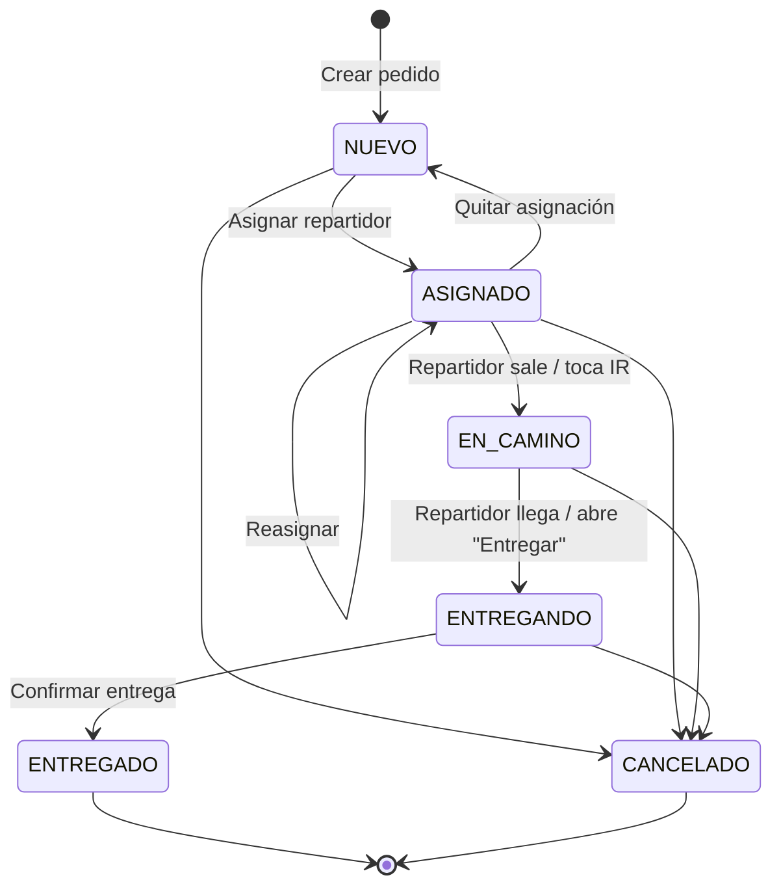
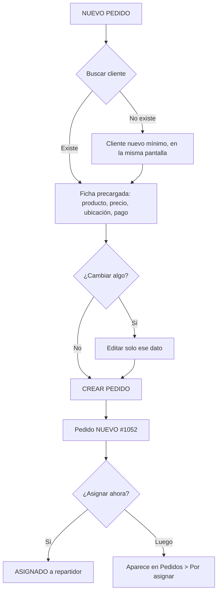
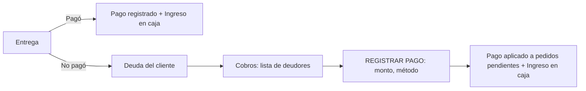
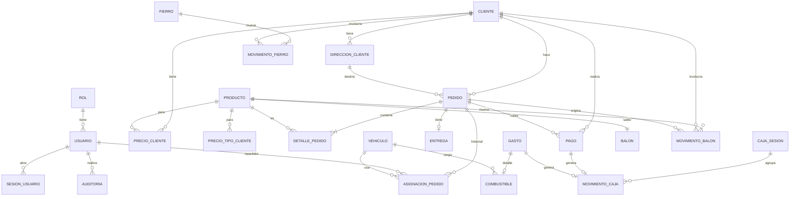

# FASE 0 — Análisis: App de Pedidos y Reparto de Gas

> Documento de análisis previo a la programación. No contiene código de la aplicación.
> Todo lo que el requerimiento no define está marcado como **DECISIÓN PENDIENTE (DP-xx)** y se resume en la sección 21.

---

## 0. Entorno de desarrollo inspeccionado

| Elemento | Estado actual | Acción para Fase 1 |
|---|---|---|
| Sistema | Ubuntu 22.04, 2 CPU, 8 GB RAM, KVM disponible | Suficiente, pero emulador Android + Gradle + Spring + MySQL a la vez será lento (ver riesgos) |
| Java | OpenJDK **17** (se requiere **21**) | Instalar JDK 21 (Temurin) |
| Flutter / Dart | **No instalado** | Instalar Flutter estable |
| Android SDK / emulador | **No instalado** (KVM sí) | Instalar cmdline-tools, platform-tools, build-tools, AVD |
| MySQL | No instalado; **Docker 29 disponible** | MySQL 8 en Docker (docker compose) |
| Repositorio | **No existe** ninguno | Crear monorepo (DP-29) |
| Internet | Disponible | — |

Nada de la app existe todavía: se construye desde cero, no hay funcionalidades previas que preservar.

---

## 1. Visión y alcance

**Problema:** llamada → pedido → cliente → ubicación → precio → reparto → entrega → cobro → balón vacío → deudas → caja → combustible → historial.

**Usuarios reales:**
- **Quien atiende** (administrador): recibe la llamada con el teléfono en la mano. Necesita registrar el pedido en segundos.
- **Repartidor**: en la calle, en moto, con una mano, con sol, señal inestable. Necesita ver a dónde ir, cuánto cobrar y confirmar la entrega.

**Fuera de alcance (no definido en el documento, no se construye salvo que se decida):** comprobantes electrónicos SUNAT, descuentos/promociones, compras a proveedores con costos, múltiples sucursales, app para el cliente final, pagos en línea, seguimiento GPS en tiempo real del repartidor.

---

## 2. Requisitos funcionales (RF)

### 2.1 Acceso
- **RF-01** Iniciar sesión con usuario y contraseña.
- **RF-02** La sesión se mantiene abierta en el dispositivo (sin pedir contraseña cada vez) hasta cerrar sesión o expirar el refresco.
- **RF-03** Cerrar sesión. El administrador puede desactivar un usuario y cerrar sus sesiones.
- **RF-04** La app muestra una interfaz distinta según el rol (administrador / repartidor).

### 2.2 Clientes
- **RF-10** Buscar cliente por teléfono (parcial) o nombre (parcial, sin tildes, sin importar mayúsculas) mientras se escribe.
- **RF-11** Ver ficha resumida: nombre, teléfono, dirección/referencia, producto y precio habitual, deuda, balones y fierros pendientes, botón **PEDIR BALÓN**.
- **RF-12** Crear cliente con: nombre (un solo campo), teléfono, tipo (PARTICULAR, RESTAURANTE, NEGOCIO, OTRO), dirección, referencia, ubicación en mapa (lat/lng), observaciones.
- **RF-13** Editar cliente. Limpiar espacios repetidos y al inicio/fin al guardar.
- **RF-14** Avisar si el teléfono ya pertenece a otro cliente (DP-19 sobre si se permite).
- **RF-15** Gestionar precios personalizados por producto.
- **RF-16** Historial del cliente: pedidos, pagos, deudas, balones, fierros, ubicaciones.
- **RF-17** Un cliente puede tener más de una dirección; una es la principal (DP-18).

### 2.3 Ubicación
- **RF-20** Elegir la ubicación en un mapa (arrastrar el pin) o usar "Mi ubicación actual" (GPS).
- **RF-21** Guardar dirección escrita + referencia + lat/lng.
- **RF-22** Botón **IR**: abre la app de navegación instalada (Google Maps, Waze u otra) con el destino.
- **RF-23** Botón **Llamar**: abre el marcador con el número del cliente.
- **RF-24** El repartidor puede registrar/corregir la ubicación real al entregar (DP-20).

### 2.4 Productos y precios
- **RF-30** Catálogo de productos: nombre, peso/capacidad, precio base, estado (activo/inactivo), descripción.
- **RF-31** Precio automático al pedir, por prioridad: precio personalizado del cliente → precio por tipo de cliente (p. ej. restaurante) → precio base (DP-02).
- **RF-32** Modificación manual del precio en el pedido solo por usuario autorizado, con motivo opcional y auditoría (DP-01).
- **RF-33** El precio aplicado se guarda en el pedido y nunca cambia aunque cambie el precio del cliente.

### 2.5 Pedidos
- **RF-40** Crear pedido en una sola pantalla: cliente → producto → precio → ubicación → forma de pago → crear.
- **RF-41** Precargar todo lo conocido del cliente (último producto, precio, dirección principal, forma de pago habitual).
- **RF-42** Crear cliente nuevo sin salir del flujo del pedido (datos mínimos).
- **RF-43** Opción de asignar repartidor en la misma pantalla (opcional).
- **RF-44** Un pedido puede tener una o más líneas (producto × cantidad). Por defecto se muestra una sola línea (DP-12).
- **RF-45** Lista de pedidos filtrable por estado (Por entregar / Entregados / Cancelados) y por día.
- **RF-46** Modificar pedido mientras no esté entregado ni cancelado.
- **RF-47** Cancelar pedido con confirmación (DP-13 motivo y quién).
- **RF-48** Estados: NUEVO, ASIGNADO, EN CAMINO, ENTREGANDO, ENTREGADO, CANCELADO.
- **RF-49** Número de pedido corto y visible (#1052) además del identificador interno.

### 2.6 Reparto
- **RF-50** Asignar/reasignar pedido a un repartidor y vehículo.
- **RF-51** El repartidor ve solo sus entregas pendientes del día, en tarjetas grandes.
- **RF-52** Detalle de entrega: cliente, llamar, dirección/referencia, IR, productos, monto a cobrar, qué entregar y qué recibir.
- **RF-53** Confirmar entrega con dos preguntas: ¿Recibió el balón vacío? (SÍ/NO) y ¿Realizó el pago? (SÍ/NO), y método si pagó.
- **RF-54** Si no recibió el vacío → queda *balón pendiente de devolución* en el cliente.
- **RF-55** Si no pagó → queda *pago pendiente* (deuda) en el cliente.
- **RF-56** Cuando aplique, preguntar por fierros entregados/recibidos (DP-06).
- **RF-57** Registrar devolución posterior de balones/fierros pendientes.

### 2.7 Balones y fierros
- **RF-60** Resumen por producto: llenos, vacíos, en clientes, pendientes de devolución.
- **RF-61** Movimientos: entrega a cliente, recepción de vacío, devolución tardía, recarga (vacíos→llenos), ajuste manual con motivo.
- **RF-62** Saldo de balones por cliente.
- **RF-63** Fierros/soportes con control separado de los balones (mismo esquema, sin mezclarse).

### 2.8 Cobros y pagos
- **RF-70** Lista de clientes con deuda (rojo) ordenada por monto/antigüedad.
- **RF-71** Detalle de deuda del cliente con pedidos pendientes.
- **RF-72** Registrar pago: monto, fecha/hora (automática), método (Efectivo, Yape, Plin, Transferencia, Otro), usuario.
- **RF-73** Impedir pagos duplicados (RN-05).
- **RF-74** Corregir/anular un pago según reglas (DP-15), siempre auditado.

### 2.9 Caja
- **RF-80** Apertura de caja con monto inicial.
- **RF-81** Movimientos automáticos por ventas cobradas, pagos de deudas, gastos y combustible.
- **RF-82** Ingresos y egresos manuales con concepto.
- **RF-83** Cierre de caja: esperado vs. contado, diferencia.
- **RF-84** Vista sencilla: saldo actual, total ingresos, total egresos, desglose por método.

### 2.10 Gastos y combustible
- **RF-90** Registrar combustible: moto, repartidor, fecha, monto, kilometraje, observación.
- **RF-91** Registrar otros gastos (categoría, monto, descripción).
- **RF-92** El repartidor solo registra los gastos autorizados (DP-10).

### 2.11 Reportes
- **RF-100** Resumen de HOY: pedidos, entregados, cancelados, ventas, cobrado, pendiente, combustible, balones pendientes.
- **RF-101** Consultar día, semana, mes o rango.
- **RF-102** Sin gráficos en la primera versión; solo cifras y listas.

### 2.12 Offline, sincronización y notificaciones
- **RF-110** El repartidor puede ver sus pedidos, clientes, ubicaciones y precios sin conexión.
- **RF-111** Entregas, pagos, devoluciones y gastos se guardan sin conexión y se sincronizan después.
- **RF-112** Banner visible "Sin conexión" y estado de sincronización.
- **RF-113** Notificaciones útiles: nuevo pedido asignado, pago pendiente, balón pendiente, pedido sincronizado.

### 2.13 Administración
- **RF-120** Gestionar usuarios (crear, desactivar, restablecer contraseña) y roles.
- **RF-121** Gestionar vehículos (Moto 01, …).
- **RF-122** Gestionar productos y precios.
- **RF-123** Auditoría consultable por el administrador.

---

## 3. Requisitos no funcionales (RNF)

| ID | Requisito | Criterio medible |
|---|---|---|
| RNF-01 | **Facilidad de uso** (requisito funcional según el documento) | Pedido de cliente existente en ≤ 3 toques tras encontrarlo y ≤ 30 s total; entrega confirmada en ≤ 3 toques |
| RNF-02 | Rapidez | Búsqueda de cliente muestra resultados < 300 ms (desde caché local); pantallas abren < 1 s |
| RNF-03 | Offline-first | Repartidor completa una entrega sin señal; cero pérdida de datos al cerrar la app |
| RNF-04 | Sin duplicados | Reintentos de red nunca crean dos pedidos, dos entregas ni dos pagos |
| RNF-05 | Seguridad | HTTPS, JWT, BCrypt, autorización por rol en backend, auditoría |
| RNF-06 | Accesibilidad | Táctil mínimo 48 dp (botones principales 56 dp), contraste WCAG AA, soporta texto grande del sistema, el color nunca es el único indicador |
| RNF-07 | Responsivo | Funciona de 320 dp a tablets pequeñas, vertical; sin tamaños fijos que rompan |
| RNF-08 | Dispositivos | Android 8.0+ (API 26) (DP-24); fluido en teléfonos de gama baja (2 GB RAM) |
| RNF-09 | Errores | Nunca mostrar mensajes técnicos; detalles solo en logs |
| RNF-10 | Mantenibilidad | Arquitectura por capas/módulos, migraciones versionadas, pruebas automáticas |
| RNF-11 | Confiabilidad | Lógica crítica en backend, transacciones en BD, respaldo diario de MySQL (DP-26) |
| RNF-12 | Idioma y formato | Español cotidiano, moneda S/ con 2 decimales, zona horaria America/Lima, fechas dd/mm/aaaa |
| RNF-13 | Escalabilidad | Preparado para más usuarios/repartidores/productos sin rehacer el modelo |
| RNF-14 | Consumo de datos y batería | Sincronización incremental; sin GPS en segundo plano continuo |

---

## 4. Reglas de negocio (RN)

Solo reglas definidas en el documento. Lo no definido va como DP.

| ID | Regla |
|---|---|
| RN-01 | Un pedido no puede marcarse como ENTREGADO más de una vez (unicidad de entrega por pedido en BD + idempotencia). |
| RN-02 | Toda entrega registra el estado del balón vacío: RECIBIDO, NO_RECIBIDO o NO_APLICA. |
| RN-03 | Toda entrega registra el estado de pago: PAGADO o PENDIENTE. |
| RN-04 | El precio unitario aplicado se guarda en el pedido; cambios posteriores de precio no lo afectan. |
| RN-05 | No se registran dos pagos iguales para la misma operación (clave de idempotencia; además aviso si coincide cliente + pedido + monto en poco tiempo, ver DP-16). |
| RN-06 | No asumir un precio único: precio general, por cliente, para restaurantes, y cambio manual autorizado. |
| RN-07 | No asumir un único tamaño de balón: los pedidos referencian productos. |
| RN-08 | El balón es un activo retornable: se registran sus movimientos, no solo existencias. |
| RN-09 | Fierros/soportes se controlan por separado; no se vinculan automáticamente con el balón. |
| RN-10 | Si el cliente ya existe, no se piden de nuevo sus datos; solo se modifican si es necesario. |
| RN-11 | Nombre del cliente en un solo campo; espacios repetidos se limpian al guardar. |
| RN-12 | Se registra quién creó el pedido, modificó precio, registró pago, confirmó entrega, registró devolución y registró gasto. |
| RN-13 | Un pedido ENTREGADO o CANCELADO no se modifica desde el flujo normal (corrección: DP-14). |
| RN-14 | El repartidor solo ve y opera pedidos asignados a él. |
| RN-15 | Caja recibe movimientos automáticos de ventas cobradas, pagos, gastos y combustible. |
| RN-16 | La deuda de un cliente = total de pedidos entregados con pago pendiente − pagos aplicados (DP-04 pagos parciales). |
| RN-17 | Balones pendientes de un cliente = entregas con NO_RECIBIDO − devoluciones posteriores. |
| RN-18 | Operaciones destructivas (cancelar pedido, anular pago) piden confirmación; las normales no. |

---

## 5. Actores y permisos

| Acción | Administrador | Repartidor |
|---|:-:|:-:|
| Buscar / ver clientes | Todos | Solo de sus pedidos (+ los cacheados) |
| Crear / editar clientes | ✓ | ✗ (salvo corregir ubicación, DP-20) |
| Gestionar productos y precios | ✓ | ✗ |
| Crear / modificar / cancelar pedidos | ✓ | ✗ (DP-13: ¿reportar "no se pudo entregar"?) |
| Asignar pedidos | ✓ | ✗ |
| Ver pedidos | Todos | Solo asignados |
| Navegar / llamar | ✓ | ✓ |
| Cambiar estado EN CAMINO / ENTREGANDO | ✓ | ✓ (sus pedidos) |
| Confirmar entrega | ✓ | ✓ (sus pedidos) |
| Registrar pagos | ✓ | ✓ (de sus pedidos; DP-21 deudas antiguas) |
| Registrar devolución de balón/fierro | ✓ | ✓ |
| Registrar combustible / gastos | ✓ | Solo autorizados (DP-10) |
| Caja (apertura, cierre, movimientos) | ✓ | ✗ (DP-09) |
| Balones: stock, recargas, ajustes | ✓ | ✗ |
| Reportes | ✓ | ✗ |
| Usuarios, vehículos, configuración | ✓ | ✗ |
| Auditoría | ✓ | ✗ |

Nota: el documento define 2 roles. Si quien atiende llamadas no debe ver caja ni reportes, se podría añadir un rol **OPERADOR** más adelante sin cambiar el modelo (DP-22).

---

## 6. Estados

### 6.1 Estado del pedido



| Estado | Color + icono (nunca solo color) | Quién lo pone |
|---|---|---|
| 🟡 NUEVO | Amarillo, "Nuevo" | Al crear |
| 🔵 ASIGNADO | Azul, "Asignado a Carlos" | Admin al asignar |
| 🟠 EN CAMINO | Naranja, "En camino" | Automático al tocar **IR** (DP-08) |
| 🟣 ENTREGANDO | Morado, "Entregando" | Automático al abrir **ENTREGAR PEDIDO** (DP-08) |
| 🟢 ENTREGADO | Verde, "Entregado" | Al confirmar entrega |
| 🔴 CANCELADO | Rojo, "Cancelado" | Admin (DP-13) |

Para no añadir pasos al repartidor, EN CAMINO y ENTREGANDO se marcan **automáticamente** como efecto de acciones que ya hace (DP-08). Si se asigna sin repartidor disponible, el pedido se puede entregar directamente desde NUEVO por el admin (p. ej. cliente recoge en local — DP-23).

### 6.2 Estado del pago (por pedido)
`PENDIENTE` → `PAGADO` (y `PARCIAL` si se aprueban pagos parciales, DP-04).

### 6.3 Estado del balón vacío (por pedido)
`POR_DEFINIR` (antes de entregar) → `RECIBIDO` | `NO_RECIBIDO` | `NO_APLICA`; `NO_RECIBIDO` → `DEVUELTO_DESPUES` cuando se registra la devolución.

---

## 7. Flujo completo del pedido (quien atiende la llamada)

```
📞 Suena el teléfono
1. Toca [➕ NUEVO PEDIDO]  (pantalla de Inicio)
2. Escribe 3-4 dígitos del teléfono o parte del nombre (campo ya enfocado, teclado numérico por defecto)
3. Toca al cliente encontrado
   → Se llena solo: producto habitual, cantidad 1, precio correcto, dirección + referencia + pin, pago habitual
   → Ve avisos: "Debe S/45" · "1 balón pendiente"
4. (Solo si cambia algo) toca "Cambiar" en producto / cantidad / dirección / pago
5. Toca [CREAR PEDIDO · S/45]
   → ✓ "Pedido #1052 creado"  (opción: asignar a Carlos en un toque)
```

**Cliente nuevo** (no aparece en la búsqueda): botón **"+ Cliente nuevo con 999 123 456"** con el teléfono ya escrito → nombre, referencia/dirección, tipo (PARTICULAR por defecto), ubicación en mapa (puede quedar para después con aviso naranja "Sin ubicación en mapa") → sigue el mismo pedido sin cambiar de pantalla.

Reglas del flujo:
- El precio sale del backend/caché según RN-06; si el usuario lo cambia y tiene permiso, se marca "precio manual" y se audita.
- El pedido se crea con un **UUID generado en el teléfono** + clave de idempotencia → si la red falla y se reintenta no se duplica.
- Sin conexión: se guarda localmente como "Pendiente de enviar" y se sincroniza (sección 13).



---

## 8. Flujo de entrega (repartidor)

```
1. Abre la app → "Tienes 5 entregas" (lista ordenada por hora de pedido; DP-25 orden por cercanía)
2. Toca [VER PEDIDO]
3. Toca [🧭 IR] → se abre Google Maps/Waze  (pedido pasa a EN CAMINO)
   · [📞 Llamar] si no encuentra la casa
4. Llega, toca [ENTREGAR PEDIDO]  (pedido pasa a ENTREGANDO)
5. Responde:
   ¿Recibió el balón vacío?  [SÍ] [NO]        (si el pedido es NO_APLICA, no se pregunta)
   ¿Realizó el pago?         [SÍ] [NO]
       si SÍ → método: [Efectivo] [Yape] [Plin] [Otro]   (Efectivo preseleccionado)
   (Fierros, solo si el pedido los incluye: entregados / recibidos)
6. Toca [CONFIRMAR ENTREGA]
   → ✓ Entregado  · ⚠️ "Balón pendiente de devolución" · ⚠️ "Pago pendiente"
   → vuelve a la lista con la siguiente entrega
```

Efectos en backend (una sola transacción):
1. Valida que el pedido esté asignado a ese repartidor y no esté ENTREGADO/CANCELADO (RN-01, RN-14).
2. Crea `entrega` (única por pedido).
3. Pedido → ENTREGADO; estado_balon y estado_pago fijados.
4. Movimiento de balón: −N llenos del stock, +N en cliente; si RECIBIDO: +N vacíos al stock, −N en cliente.
5. Si PAGADO: crea `pago` + movimiento de caja (ingreso). Si PENDIENTE: aumenta deuda del cliente.
6. Auditoría: "Carlos confirmó entrega #1052".

Caso **no se pudo entregar** (cliente ausente, dirección equivocada): DP-13. Propuesta: botón secundario pequeño "No se pudo entregar" → motivo de una lista → pedido vuelve a ASIGNADO/NUEVO y avisa al admin.

---

## 9. Flujo de pagos



- **En la entrega:** monto = total del pedido (no se escribe nada).
- **Después (Cobros):** se abre el cliente → "Deuda total S/45" → **REGISTRAR PAGO** con el monto total precargado → método → guardar.
- Aplicación del pago: al pedido elegido, o automáticamente a los más antiguos primero (DP-04, DP-05).
- **Anti-duplicado:** cada pago lleva `idempotency_key` (UUID del teléfono). El backend rechaza la misma clave y además avisa "Ya registraste S/45 de Juan hace 2 min, ¿registrar otro?" si coincide cliente + monto en ventana corta (DP-16).
- Corrección: solo administrador, mediante **anulación** (no borrado) + nuevo pago, con auditoría (DP-15).
- Cada pago genera su movimiento de caja (DP-03, DP-09).

---

## 10. Flujo de devolución de balones (y fierros)

```
Entrega con vacío RECIBIDO      → stock vacíos +1, cliente sin pendiente
Entrega con vacío NO_RECIBIDO   → cliente: 1 balón pendiente  (⚠️ visible en su ficha, en Inicio y al próximo pedido)
Devolución posterior            → Cliente > Balones > [REGISTRAR DEVOLUCIÓN] (cantidad) → vacíos +1, pendiente −1
                                   o en la siguiente entrega: "Este cliente debe 1 balón. ¿Lo devolvió?" [SÍ] [NO]
Recarga en planta (admin)       → vacíos −N, llenos +N  (DP-07)
Ajuste (admin)                  → +/− con motivo obligatorio, auditado
```

Saldos (todos calculados desde el libro de movimientos):
- **Llenos / Vacíos** por producto = suma de movimientos de stock.
- **Pendientes de devolución** = Σ por cliente de (NO_RECIBIDO − devoluciones).
- **En clientes**: significado a confirmar (DP-07). Propuesta: envases del negocio en poder de clientes (pendientes + préstamos).

**Fierros:** mismo esquema, tablas propias, cantidades independientes. Solo se pregunta por fierros si el pedido los marcó (o el cliente los usa habitualmente, DP-06).

---

## 11. Modelo de datos propuesto (MySQL 8, InnoDB, utf8mb4)

Convenciones: PK `BIGINT` autoincremental en tablas internas; **`CHAR(36)` UUID** en entidades que se crean offline (pedido, entrega, pago, movimientos, gasto, combustible) para evitar duplicados; dinero `DECIMAL(10,2)`; fechas `DATETIME(3)` en UTC (se muestran en America/Lima); columnas comunes `created_at`, `created_by`, `updated_at`, `version` (bloqueo optimista). Borrado lógico (`activo`) para catálogos; nunca se borran pedidos, pagos ni movimientos.

### 11.1 Tablas

| Tabla | Campos principales | Notas |
|---|---|---|
| `rol` | id, codigo (ADMINISTRADOR, REPARTIDOR), nombre | Tabla para crecer (OPERADOR) |
| `usuario` | id, nombre, usuario (único), password_hash, rol_id, telefono, vehiculo_id_habitual, activo | BCrypt |
| `sesion_usuario` | id, usuario_id, refresh_token_hash, dispositivo, expira_en, revocada | Control de sesiones (técnica, necesaria para RF-03) |
| `cliente` | id, nombre, nombre_busqueda (sin tildes, minúsculas), telefono, tipo (ENUM), observaciones, producto_habitual_id, forma_pago_habitual, activo | Índices en telefono y nombre_busqueda |
| `direccion_cliente` | id, cliente_id, etiqueta ("Casa", "Local"), direccion, referencia, latitud DECIMAL(10,7), longitud DECIMAL(10,7), principal, activo | Varias por cliente |
| `producto` | id, nombre, capacidad_kg, precio_base, descripcion, retornable, activo | Balón 10/15/45 kg |
| `precio_tipo_cliente` | id, tipo_cliente, producto_id, precio | "Precio para restaurantes" (DP-02). Única (tipo, producto) |
| `precio_cliente` | id, cliente_id, producto_id, precio, vigente_desde, vigente_hasta, created_by | Historial de precios; vigente = vigente_hasta NULL |
| `vehiculo` | id, nombre ("Moto 01"), placa, activo | |
| `pedido` | id UUID, numero (secuencial único, visible), cliente_id, direccion_cliente_id, direccion_texto, referencia_texto, latitud, longitud, forma_pago, estado, estado_pago, estado_balon, total, usa_fierro, cant_fierros, repartidor_id, vehiculo_id, observaciones, fecha_pedido, created_by, cancelado_por, motivo_cancelacion | Ubicación copiada (snapshot) para que el pedido no cambie si el cliente se muda. repartidor_id = asignación vigente (desnormalizado para consultas rápidas) |
| `detalle_pedido` | id, pedido_id, producto_id, cantidad, precio_unitario, origen_precio (BASE/TIPO/CLIENTE/MANUAL), subtotal | Precio congelado (RN-04) |
| `asignacion_pedido` | id, pedido_id, repartidor_id, vehiculo_id, asignado_por, asignado_en, vigente | Historial de reasignaciones |
| `entrega` | id UUID, pedido_id **UNIQUE**, repartidor_id, estado_balon, vacios_recibidos, estado_pago, fierros_entregados, fierros_recibidos, latitud, longitud, entregado_en (hora del teléfono), sincronizado_en | UNIQUE impide doble entrega (RN-01) |
| `pago` | id UUID, idempotency_key **UNIQUE**, cliente_id, pedido_id NULL, monto, metodo, pagado_en, registrado_por, anulado, anulado_por, motivo_anulacion | |
| `pago_aplicacion` | id, pago_id, pedido_id, monto | Solo si se aprueban pagos que cubren varios pedidos (DP-05) |
| `caja_sesion` | id, abierta_por, abierta_en, monto_inicial, cerrada_por, cerrada_en, monto_esperado, monto_contado, diferencia, estado | Necesaria para apertura/cierre (no estaba en la lista; DP-09) |
| `movimiento_caja` | id UUID, caja_sesion_id, tipo (INGRESO/EGRESO), concepto (VENTA, COBRO_DEUDA, GASTO, COMBUSTIBLE, OTRO), metodo, monto, origen_tipo, origen_id, descripcion, registrado_por, fecha | Origen = pago/gasto |
| `balon` | id, producto_id **UNIQUE**, llenos, vacios | Saldo actual por producto (caché transaccional del libro). DP-07 si se requieren balones con número de serie |
| `movimiento_balon` | id UUID, producto_id, tipo (ENTREGA_CLIENTE, RECEPCION_VACIO, DEVOLUCION_POSTERIOR, RECARGA, AJUSTE, PRESTAMO…), cantidad, cliente_id NULL, pedido_id NULL, motivo, registrado_por, fecha | Libro de verdad |
| `fierro` | id, nombre/tipo, disponibles | Saldo |
| `movimiento_fierro` | id UUID, fierro_id, tipo, cantidad, cliente_id, pedido_id, motivo, registrado_por, fecha | Independiente de balones (RN-09) |
| `gasto` | id UUID, categoria (COMBUSTIBLE, MANTENIMIENTO, OTRO…), monto, descripcion, vehiculo_id NULL, registrado_por, fecha, aprobado | |
| `combustible` | id, gasto_id UNIQUE, vehiculo_id, repartidor_id, kilometraje, observacion | Especializa a `gasto`: un solo lugar para totales de gastos |
| `auditoria` | id, usuario_id, accion, entidad, entidad_id, antes JSON, despues JSON, dispositivo, fecha | |
| `operacion_sync` | idempotency_key PK, usuario_id, tipo, entidad_id, resultado JSON, recibido_en | Técnica: evita reprocesar operaciones offline |

Vistas/consultas (no tablas): `deuda_cliente`, `saldo_balones_cliente`, `saldo_fierros_cliente`, resumen de reportes.

### 11.2 Diagrama entidad-relación (simplificado)



---

## 12. Arquitectura técnica

```
┌─────────────────────────── Flutter APK (Android) ───────────────────────────┐
│ presentation (pantallas, widgets, controladores Riverpod)                    │
│ domain (entidades, casos de uso, reglas de UI: precio, validaciones)         │
│ data (repositorios → fuente remota Dio + fuente local SQLite/Drift)          │
│ core: tema, red, errores amigables, almacenamiento seguro, motor de sync     │
└───────────────┬──────────────────────────────────────────────────────────────┘
                │ HTTPS · REST · JSON · JWT (Authorization: Bearer) · Idempotency-Key
┌───────────────▼──────────────────── Spring Boot 3 (Java 21) ─────────────────┐
│ api (controllers + DTO + validación)  →  servicios (reglas de negocio,        │
│ transacciones)  →  repositorios JPA  →  MySQL 8                               │
│ Spring Security + JWT · Flyway · auditoría · manejador global de errores      │
└───────────────┬──────────────────────────────────────────────────────────────┘
                │
        ┌───────▼───────┐   Respaldo diario (mysqldump) · Proxy HTTPS (Caddy/Nginx + Let's Encrypt)
        │   MySQL 8     │
        └───────────────┘
```

### 12.1 Backend
- **Java 21, Spring Boot 3.x**, Maven.
- Spring Web, Spring Data JPA (Hibernate), Bean Validation, Spring Security.
- **JWT**: access token corto (~30 min) + refresh token rotativo guardado (hash) en `sesion_usuario` → permite cerrar sesiones y desactivar usuarios. Para el repartidor offline, el refresh dura varios días (DP-27).
- **Flyway** para migraciones versionadas del esquema.
- **springdoc-openapi** (documentación de la API).
- Errores: `@RestControllerAdvice` devuelve `{ "codigo": "PEDIDO_YA_ENTREGADO", "mensaje": "Este pedido ya fue entregado." }`; detalles técnicos solo en logs (con id de correlación).
- Idempotencia: filtro/servicio que lee `Idempotency-Key` en POST críticos y guarda el resultado en `operacion_sync`.
- Bloqueo optimista (`@Version`) + restricciones UNIQUE en BD como última barrera.
- Auditoría: servicio explícito llamado desde los casos de uso críticos (más claro que triggers).
- Pruebas: JUnit 5, Mockito, **Testcontainers (MySQL real)**, MockMvc para seguridad.
- Despliegue: Docker Compose (api + mysql + proxy HTTPS). Servidor: DP-17.

### 12.2 App Flutter
| Necesidad | Paquete propuesto | Motivo |
|---|---|---|
| Estado | **Riverpod** | Testeable, sin estado global desordenado, sin `BuildContext` en lógica |
| Navegación | **go_router** | Rutas por rol, botón atrás predecible |
| HTTP | **Dio** + interceptores | JWT, refresh automático, timeouts, errores amigables |
| BD local | **Drift (SQLite)** | Caché offline + cola de sincronización con transacciones |
| Credenciales | flutter_secure_storage | Tokens cifrados |
| Mapa | **flutter_map (OpenStreetMap)** o google_maps_flutter | DP-11 |
| GPS | geolocator | "Mi ubicación actual" |
| IR / Llamar | url_launcher | Abre navegación (`geo:` / Google Maps URL) y marcador |
| Conectividad | connectivity_plus + ping al backend | Banner "Sin conexión" |
| Segundo plano | workmanager | Sincronizar aunque la app esté cerrada |
| Notificaciones | flutter_local_notifications (+ FCM opcional) | DP-28 |
| Modelos | freezed + json_serializable | Inmutables, menos errores |

Idioma: español, `intl` para S/ y fechas. Tema Material 3 propio.

---

## 13. Estructura inicial del proyecto (monorepo)

```
gas-reparto/
├── docs/                      # esta documentación, decisiones, API
├── backend/                   # Spring Boot
│   ├── pom.xml
│   └── src/main/java/pe/gas/reparto/
│       ├── common/            # errores, auditoría, idempotencia, seguridad, config
│       ├── auth/              # login, refresh, logout, JWT
│       ├── usuarios/          # usuarios, roles, vehículos
│       ├── clientes/          # clientes, direcciones, historial
│       ├── productos/         # productos, precios (cliente, tipo)
│       ├── pedidos/           # pedidos, detalle, asignación, estados
│       ├── entregas/          # confirmación de entrega
│       ├── balones/           # balones, fierros, movimientos
│       ├── pagos/             # pagos, deudas
│       ├── caja/              # sesiones y movimientos de caja
│       ├── gastos/            # gastos, combustible
│       ├── reportes/
│       └── sync/              # pull incremental para offline
│   (cada módulo: api/ [controller, dto] · domain/ [entidad, servicio] · repository/)
│   └── src/main/resources/db/migration/   # Flyway V1__...sql
├── app/                       # Flutter
│   └── lib/
│       ├── main.dart
│       ├── core/              # theme/, network/, errors/, storage/, sync/, router/
│       ├── shared/widgets/    # PrimaryButton, StatusBadge, EmptyState, LoadingState,
│       │                      # OrderCard, CustomerCard, PaymentCard, BallStatusCard, OfflineBanner
│       └── features/
│           ├── auth/          ├── home/        ├── clientes/   ├── pedidos/
│           ├── reparto/       ├── cobros/      ├── balones/    ├── caja/
│           ├── combustible/   ├── reportes/    └── configuracion/
│           (cada feature: data/ [models, datasources, repositories] ·
│            domain/ [entidades, casos de uso] · presentation/ [screens, widgets, controllers])
├── docker-compose.yml         # mysql (+ api para pruebas)
└── README.md
```

---

## 14. API REST (propuesta)

Base `/api`. JSON. Todas protegidas con JWT salvo login/refresh. POST críticos aceptan `Idempotency-Key`.

| Método | Ruta | Rol | Uso |
|---|---|---|---|
| POST | /auth/login · /auth/refresh · /auth/logout | — | Sesión |
| GET | /auth/me | ambos | Perfil y rol |
| GET | /clientes?q= | admin | Búsqueda por nombre/teléfono |
| POST / GET / PUT | /clientes · /clientes/{id} | admin | CRUD |
| GET | /clientes/{id}/historial?tipo= | admin | Pedidos, pagos, balones, fierros, ubicaciones |
| POST / PUT | /clientes/{id}/direcciones[/{dirId}] | admin (repartidor: ubicación, DP-20) | Direcciones |
| GET / PUT | /clientes/{id}/precios | admin | Precios personalizados |
| GET | /clientes/{id}/precio?productoId= | ambos | Precio resuelto |
| GET / POST / PUT | /productos · /productos/{id} | admin (GET ambos) | Catálogo |
| GET / PUT | /precios/tipo-cliente | admin | Precios por tipo |
| GET | /pedidos?estado=&fecha=&repartidorId= | admin | Lista |
| GET | /pedidos/mios | repartidor | Mis entregas |
| POST / GET / PUT | /pedidos · /pedidos/{id} | admin | Crear (UUID del cliente) / ver / modificar |
| POST | /pedidos/{id}/asignar | admin | Asignar/reasignar |
| POST | /pedidos/{id}/en-camino · /entregando | ambos | Estados automáticos |
| POST | /pedidos/{id}/entregar | ambos | Confirmar entrega (idempotente) |
| POST | /pedidos/{id}/no-entregado | repartidor | DP-13 |
| POST | /pedidos/{id}/cancelar | admin | Cancelar |
| GET | /cobros | admin | Clientes con deuda |
| GET / POST | /pagos | admin / ambos | Listar / registrar (idempotente) |
| POST | /pagos/{id}/anular | admin | DP-15 |
| GET | /balones | admin | Resumen por producto |
| GET | /balones/clientes | admin | Pendientes por cliente |
| POST | /balones/movimiento | ambos* | Devolución, recarga, ajuste (*repartidor solo devolución) |
| GET / POST | /fierros · /fierros/movimiento | admin / ambos* | Igual que balones |
| GET | /caja/actual | admin | Sesión abierta y saldo |
| POST | /caja/abrir · /caja/cerrar · /caja/movimiento | admin | Caja |
| GET / POST | /gastos | admin / ambos* | Gastos |
| GET / POST | /combustible | admin / ambos | Combustible |
| GET / POST / PUT | /usuarios · /vehiculos | admin | Administración |
| GET | /reportes/resumen?desde=&hasta= | admin | Reportes |
| GET | /sync/pull?desde= | ambos | Cambios incrementales para caché |
| GET | /auditoria | admin | Consulta |

---

## 15. Estrategia offline

**Principio:** el servidor es la fuente de verdad; el teléfono trabaja contra su base local y sincroniza.

**Qué se guarda en el teléfono (Drift/SQLite):**
- Repartidor: sus pedidos asignados (pendientes + entregados del día), los clientes de esos pedidos con dirección/referencia/lat/lng, productos y precios aplicables, saldos de deuda/balones de esos clientes, vehículos.
- Administrador: clientes (para búsqueda instantánea durante la llamada), productos y precios, pedidos del día. (DP-26b: ¿el admin también debe operar offline o basta con avisar?)

**Lecturas:** la pantalla muestra primero lo local (instantáneo) y refresca en segundo plano; indicador discreto "Actualizado hace 2 min".

**Escrituras offline (cola "outbox"):** cada operación se guarda en la tabla local `operacion_pendiente` (id UUID = Idempotency-Key, tipo, payload, intentos, estado, error) **en la misma transacción** que el cambio local optimista. La UI la muestra como hecha con un icono de reloj "Por sincronizar".

Operaciones offline permitidas: confirmar entrega, en camino/entregando, registrar pago, devolución de balón/fierro, combustible/gasto, corregir ubicación; para admin: crear cliente y pedido (con UUID local; el número #1052 lo asigna el servidor al sincronizar, mientras tanto se muestra "Pedido nuevo (sin enviar)").

No permitidas offline (requieren servidor): asignar pedidos a otros, cerrar caja, cambiar precios, gestionar usuarios, reportes.

**Seguridad local:** tokens en almacenamiento seguro; al cerrar sesión se borra la BD local; caché limitada a lo necesario.

Mensaje al usuario:
```
📡 Sin conexión
Los cambios se guardarán y se sincronizarán cuando vuelva Internet.
```

---

## 16. Estrategia de sincronización

1. **Disparadores:** recuperar conexión, abrir/volver a la app, después de cada operación, cada 15 min con WorkManager, "deslizar para actualizar".
2. **Push (subir):** se envía la cola en orden FIFO, una operación a la vez por entidad, con `Idempotency-Key`.
   - `2xx` → se marca hecha y se actualiza la entidad local con la respuesta del servidor (número de pedido, saldos).
   - Misma clave ya procesada → el servidor devuelve el resultado guardado (no duplica) → se marca hecha.
   - Error de red/5xx → reintento con espera creciente (5 s, 30 s, 2 min… máx. 15 min).
   - Error de negocio (409/422, p. ej. "pedido cancelado por el administrador") → no se reintenta; queda en **"Necesita revisión"** con mensaje claro y aviso al admin.
   - 401 → refresh del token y reintento; si el refresh expiró, se pide iniciar sesión **sin borrar la cola**.
3. **Pull (bajar):** `GET /sync/pull?desde=<marca>` devuelve solo lo cambiado (y eliminaciones lógicas) dentro del alcance del usuario; se aplica en transacción local.
4. **Conflictos:**
   - Entrega vs. cancelación: si el admin canceló mientras el repartidor entregaba sin señal, el servidor registra la entrega como **conflicto** y avisa al admin para decidir (no se pierde el hecho real). (DP-14)
   - Ediciones de cliente: gana la última escritura del servidor con `version`; si chocan, se conserva la del servidor y se avisa.
   - Doble entrega: imposible por `UNIQUE(pedido_id)` + idempotencia.
5. **Hora:** se guarda la hora real del teléfono (`entregado_en`) y la de recepción del servidor (`sincronizado_en`).
6. **Feedback:** `✓ Sincronizando… ✓ Entrega registrada ✓ Pago registrado`; contador de pendientes en la cabecera.

---

## 17. Navegación

### Administrador (barra inferior de 5)
```
🏠 Inicio   📦 Pedidos   👥 Clientes   💰 Cobros   ☰ Más
                                                    ├─ 🛢️ Balones (y fierros)
                                                    ├─ ⛽ Combustible
                                                    ├─ 💵 Caja
                                                    ├─ 📊 Reportes
                                                    └─ ⚙️ Configuración (productos y precios, usuarios, vehículos, cerrar sesión)
```
- **Nuevo pedido** está siempre a un toque: botón grande en Inicio + botón flotante en Pedidos y Clientes.
- Profundidad máxima: 2 niveles desde la barra. Título de pantalla siempre visible y flecha atrás.

### Repartidor (barra inferior de 3)
```
🚚 Entregas   💰 Cobros   ☰ Más (⛽ Combustible/Gasto, Mi perfil, Cerrar sesión)
```
Sin pantallas administrativas: las rutas están protegidas también en el backend.

---

## 18. Propuesta UX/UI

**Estilo:** Material 3, fondo claro (#F7F8FA), tarjetas blancas con borde suave y sombra mínima, esquinas 16 dp, espaciado base 8 dp (16/24 en bloques), tipografía del sistema (Roboto) con tamaños grandes (cuerpo 16 sp, títulos 22–28 sp).

**Color:** un color principal sobrio (propuesta: azul petróleo `#1E5A7A`, DP-30). Semánticos solo con significado: verde completado, ámbar/naranja pendiente, rojo problema; siempre acompañados de icono y texto.

**Componentes reutilizables:** PrimaryButton (56 dp, ancho completo), SecondaryButton, StatusBadge (icono+texto), OrderCard, CustomerCard, PaymentCard, BallStatusCard, SearchField, MoneyText, EmptyState, LoadingState (skeleton), ErrorState (mensaje + Reintentar), OfflineBanner, ConfirmDialog (solo destructivas), YesNoSelector (dos botones grandes).

**Pantallas clave:**

*Inicio (admin)*
```
Buenos días, Rosa 👋
¿Qué necesitas hacer?
[ ➕  NUEVO PEDIDO ]                (botón principal, ancho completo)
[ 📦 Pedidos ]  [ 👥 Clientes ]
[ 💰 Cobros  ]  [ 🛢️ Balones  ]
Hoy
🟡 5 pedidos por entregar   ›
🔴 2 cobros pendientes      ›
🟠 3 balones por devolver   ›
```
Cada línea de "Hoy" lleva a la lista filtrada.

*Nuevo pedido (una sola pantalla con secciones que se autocompletan)*
```
← Nuevo pedido
[🔍 Teléfono o nombre        ]
┌ Juan Pérez · 999 999 999        [Cambiar] ┐
│ ⚠️ Debe S/45 · 1 balón pendiente          │
└───────────────────────────────────────────┘
Balón      [10 kg ✓] [15 kg] [45 kg]
Cantidad   [ − ] 1 [ + ]
Precio     S/45  (precio de Juan)   [✎]
Entrega    📍 Casa azul, frente al parque  [Cambiar]
Pago       [Efectivo ✓] [Yape] [Plin] [Debe]
Asignar    [Carlos ✓] [Luis] [Después]
[  CREAR PEDIDO · S/45  ]
```

*Repartidor:* como en el documento (secciones 14–15), con botones **IR** y **ENTREGAR PEDIDO** de ancho completo y la confirmación con dos selectores SÍ/NO grandes.

**Estados vacíos, carga y errores:** cada lista tiene un EmptyState con frase cotidiana; skeletons en listas; botones muestran indicador al guardar y se bloquean para evitar doble toque; errores con texto humano + "Reintentar".

**Revisión UX por módulo (checklist del documento, sección 42):** se aplicará al cierre de cada fase; se medirán toques y segundos de los flujos principales (RNF-01).

---

## 19. Riesgos técnicos

| Riesgo | Impacto | Mitigación |
|---|---|---|
| Sincronización offline genera duplicados o conflictos | Alto | UUID en el cliente, Idempotency-Key, UNIQUE en BD, pruebas específicas, bandeja "Necesita revisión" |
| Mapas: Google Maps exige API key y facturación | Medio | OpenStreetMap (flutter_map) para elegir ubicación; "IR" usa la app de navegación del teléfono (sin costo) — DP-11 |
| Precisión del GPS / ubicaciones mal puestas | Alto | Mover pin manualmente, referencia escrita obligatoria, el repartidor puede corregir (DP-20) |
| Android mata procesos en segundo plano (ahorro de batería) | Medio | WorkManager + sincronizar al abrir la app; la cola local no se pierde |
| Teléfonos de gama baja / pantallas pequeñas | Medio | Pruebas en emulador 320 dp y texto grande; listas paginadas; imágenes nulas |
| Notificaciones push requieren Firebase | Bajo | Empezar con notificaciones locales al sincronizar; FCM como mejora (DP-28) |
| Servidor, dominio y certificado HTTPS no definidos | Alto | Docker Compose + Caddy (HTTPS automático) en un VPS — DP-17 |
| Pérdida de datos del servidor | Alto | Respaldo diario automático y prueba de restauración (DP-26) |
| Robo/pérdida del teléfono del repartidor | Medio | Revocar sesión desde admin; caché mínima; tokens cifrados |
| Distribución del APK (sin Play Store) | Bajo | APK firmado instalado manualmente; actualizaciones con aviso de versión (DP-24) |
| Reglas de negocio ambiguas (caja, fierros, envases) | Alto | Lista de DPs; soluciones configurables; validar antes de cada fase |
| Entorno: 2 CPU / 8 GB para emulador + builds | Medio | Ejecutar servicios por separado; pruebas de backend sin emulador |
| Crecimiento del alcance (convertirse en ERP) | Alto | Cada función nueva pasa la checklist UX; priorizar sección 45 |

---

## 20. Plan de implementación por fases

| Fase | Contenido | Entregable / criterio de aceptación |
|---|---|---|
| **0 Análisis** | Este documento | Aprobación + respuesta a las DP bloqueantes |
| **1 Esqueleto** | Instalar JDK 21, Flutter, Android SDK; monorepo; Spring Boot + Flyway + MySQL (Docker); seguridad JWT (login/refresh/logout, roles); Flutter con tema, go_router, Dio, Drift, login y navegación por rol con pantallas vacías (EmptyState); CI básico (build + tests) | APK debug instala, inicia sesión como admin y repartidor y ve su navegación; backend con pruebas de seguridad verdes |
| **2 Clientes** | CRUD, búsqueda instantánea, direcciones con mapa, IR/Llamar, historial (estructura), limpieza de espacios | Crear/editar/buscar cliente con ubicación en < 1 min; pruebas de clientes |
| **3 Pedidos** | Productos, precios (base/tipo/cliente/manual), creación rápida en una pantalla, cliente nuevo inline, estados, lista, edición, cancelación, auditoría | Pedido de cliente existente en ≤ 30 s; precio congelado probado |
| **4 Repartos** | Asignación, "Mis entregas", detalle, IR, estados automáticos, confirmación de entrega (vacío/pago), no entregado | Flujo completo admin→repartidor en 2 teléfonos; doble entrega imposible |
| **5 Balones** | Stock por producto, libro de movimientos, pendientes por cliente, devoluciones, recargas, ajustes, fierros | Saldos cuadran con movimientos en pruebas |
| **6 Caja y cobros** | Pagos, deudas, anti-duplicado, caja (apertura/movimientos/cierre), gastos, combustible | Cierre de caja cuadra; pagos duplicados bloqueados |
| **7 Offline** | Caché local completa, outbox, sync push/pull, conflictos, banner, WorkManager, notificaciones locales | Entrega + pago sin señal se sincronizan sin duplicar (pruebas automáticas + manuales en modo avión) |
| **8 Reportes** | Resumen hoy, día/semana/mes/rango, ventas, cobros, deudas, combustible, balones | Cifras coinciden con datos de prueba |
| **9 Calidad** | Revisión UX con usuarios reales, rendimiento, seguridad (OWASP básico), APK release firmado, despliegue HTTPS, respaldos | APK release + servidor en producción + manual corto |

Nota: aunque la Fase 7 concentra el offline, desde la Fase 1 se usan UUID en cliente, Idempotency-Key y repositorios con fuente local para no rehacer nada después.

---

## 21. DECISIONES PENDIENTES

**Bloquean el inicio (Fase 1):**
- **DP-17** ¿Dónde se alojará el backend (VPS propio, nube, PC del negocio)? ¿Hay dominio? (Para Fase 1 basta local/Docker; se necesita antes de usar en la calle.)
- **DP-29** ¿Crear un repositorio en GitHub (monorepo `backend/` + `app/` + `docs/`)? ¿Nombre y cuenta?
- **DP-24** Versión mínima de Android de los teléfonos que se usarán (propuesta: Android 8.0+). ¿Se instalará el APK manualmente o vía Play Store?

**Necesarias antes de Fase 3 (Pedidos/precios):**
- **DP-01** ¿Quién puede cambiar el precio manualmente en un pedido? (Propuesta: solo administrador.)
- **DP-02** Prioridad de precios: ¿precio del cliente → precio por tipo (restaurante) → precio base? ¿El "precio para restaurantes" es por tipo de cliente o se pone cliente por cliente?
- **DP-12** ¿Un pedido puede llevar varios productos distintos (ej. 1 de 10 kg + 1 de 45 kg)? (El modelo lo soporta.)
- **DP-13** Cancelación: ¿quién puede cancelar, se exige motivo? ¿El repartidor puede marcar "no se pudo entregar"?
- **DP-18** ¿Un cliente puede tener varias direcciones (casa y negocio)?
- **DP-19** ¿Se permite el mismo teléfono en dos clientes (ej. familia)?
- **DP-23** ¿Existen ventas en el local sin reparto (cliente recoge)?
- **DP-30** Color principal y nombre de la app / logo.

**Necesarias antes de Fase 4 (Reparto):**
- **DP-08** ¿EN CAMINO y ENTREGANDO se marcan automáticamente (al tocar IR / al abrir Entregar) o el repartidor los marca a mano?
- **DP-11** Mapa: OpenStreetMap (gratis) o Google Maps (requiere API key con facturación).
- **DP-20** ¿El repartidor puede corregir la ubicación del cliente al entregar?
- **DP-21** ¿El repartidor puede cobrar deudas antiguas del cliente durante una entrega?
- **DP-25** Orden de la lista del repartidor: por hora del pedido, por cercanía, o manual por el admin.
- **DP-27** ¿Cuántos días puede trabajar un repartidor sin conexión antes de pedir iniciar sesión de nuevo?

**Necesarias antes de Fase 5 (Balones/fierros):**
- **DP-05b** ¿Se vende el balón con envase (cliente sin vacío para cambiar)? ¿Tiene otro precio? ¿Cuándo aplica NO_APLICA?
- **DP-06** Fierros: ¿qué clientes los usan, se cobra algo, se entregan en cada pedido o solo una vez (préstamo)?
- **DP-07** ¿Balones controlados por cantidad (propuesta) o individualmente con número de serie? ¿Qué significa exactamente "en clientes" (envases del negocio prestados vs. pendientes)? ¿Cómo se registra la recarga en planta?

**Necesarias antes de Fase 6 (Caja/cobros):**
- **DP-03** ¿La caja registra solo dinero realmente recibido (propuesta) o también ventas al crédito?
- **DP-04** ¿Se aceptan pagos parciales (paga S/20 de S/45)?
- **DP-05** Un pago de deuda: ¿se aplica a un pedido específico o automáticamente a los más antiguos?
- **DP-09** ¿Una sola caja del negocio, o cada repartidor maneja su efectivo y luego "rinde cuentas"? ¿Yape/Plin entran a la misma caja?
- **DP-10** ¿Qué gastos puede registrar el repartidor (solo combustible)? ¿Requieren aprobación? ¿Tope?
- **DP-15** ¿Cómo se corrige un pago mal registrado? (Propuesta: solo admin anula y registra de nuevo, auditado.)
- **DP-16** Criterio de "pago duplicado": ¿mismo cliente + mismo monto en cuántos minutos se avisa?

**Otras (pueden decidirse después):**
- **DP-14** ¿Se puede revertir una entrega confirmada por error? ¿Quién?
- **DP-22** ¿Hará falta un rol OPERADOR (atiende llamadas sin ver caja/reportes)?
- **DP-26** Respaldos: frecuencia y dónde guardarlos. **DP-26b** ¿El administrador también debe poder crear pedidos sin Internet?
- **DP-28** ¿Notificaciones push con Firebase (requiere cuenta Google/Firebase) o solo notificaciones locales al inicio?
- **DP-31** ¿Se necesitan boletas/facturas electrónicas (SUNAT) en el futuro?
- Volumen aproximado: ¿cuántos pedidos al día, cuántos repartidores, cuántos clientes? (Ayuda a dimensionar servidor.)
